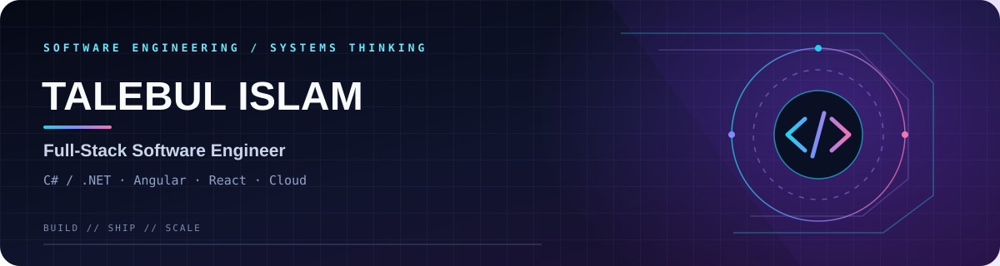
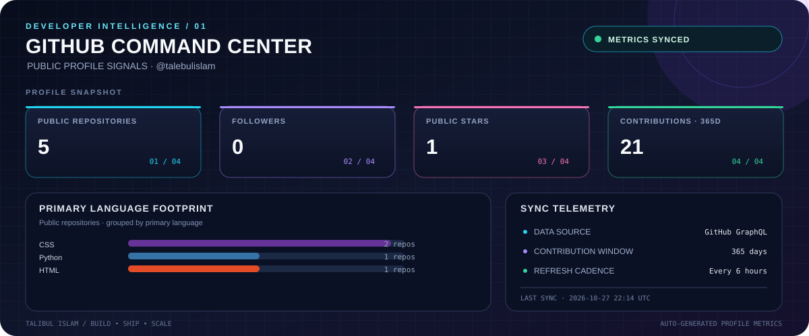
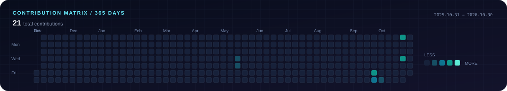

  
   
  
  
  
  
    
  
  
  

01 / Profile Brief
I build maintainable web applications, backend services, and API-driven products, with a focus on practical engineering, clean architecture, and reliable delivery.
Domain	Focus
Backend engineering	C#, .NET / ASP.NET Core, REST APIs, Node.js
Frontend engineering	Angular, React, TypeScript, JavaScript, HTML, CSS
Data	SQL Server, Entity Framework Core, data access
Cloud & delivery	Azure, AWS, GCP, Docker, Kubernetes, CI/CD
Engineering	Modular design, debugging, code reviews, Agile, SDLC

02 / Live GitHub Telemetry
The cards below are generated inside this repository by GitHub Actions, rather than relying on third-party stats-card hosting. The workflow refreshes them every six hours and when the profile README or metrics workflow changes.

  
   
  

Data note: GitHub Actions is scheduled, not second-by-second live. The dashboard is refreshed every six hours; GitHub may also take time to process or expose contribution activity. To refresh manually, open Actions → Refresh GitHub Profile Metrics → Run workflow in this repository.

03 / Technology Matrix

  

04 / Selected Work
Personal Portfolio
A responsive portfolio showcasing experience, technical skills, certifications, selected work, and contact details.

HTML CSS JavaScript · Source code
PharmacyApp
An ASP.NET Core application targeting .NET 8, with a structured controller, data, and model layout.

C# ASP.NET Core .NET 8
Cloud Architecture Capstone
A cloud-architecture learning capstone covering deployment concepts and load balancing.

Cloud architecture Deployment Load balancing
05 / Connect

  <a href="https://talebulislam.github.io/">Portfolio</a> ·
  <a href="https://www.linkedin.com/in/talebulislam">LinkedIn</a> ·
  <a href="mailto:talebullislam852218@gmail.com">Email</a> ·
  <a href="https://github.com/talebulislam">GitHub</a>

BUILD WITH INTENT · SHIP WITH CONFIDENCE · KEEP IMPROVING

